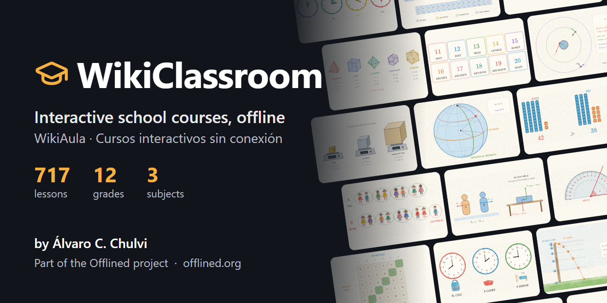

# 🎓 WikiClassroom

**Interactive school courses that work without internet.**
By **Álvaro C. Chulvi** · a project of **[Offlined](https://www.offlined.org)** · in Spanish: **WikiAula**

[English](#english) · [Español](#español)

---

## English

WikiClassroom is the course library behind **Wikis → WikiAula** in [Offlined](https://www.offlined.org),
the app that brings Wikipedia, maps and AI to your computer without internet. Each language is **one
[ZIM](https://wiki.openzim.org/wiki/ZIM_file_format) file** with every course in it:

- **Lessons written like an encyclopedia article**, with hand-drawn watercolour figures, formulas,
  worked examples, common mistakes and links to the matching Wikipedia articles.
- **Exercises that change every time** (generated, never the same numbers twice), a mastery level per
  lesson, a test per unit with medals, spaced review, experience points, streaks and achievements.
- **Maths from grade 1 to grade 12, Physics and Chemistry from grade 8 to grade 12.**

### Downloads

| Language | File | Courses | Lessons | Size | Status |
|---|---|---:|---:|---:|---|
| English (US) | [`wikiaula_en_all_2026-11.zim`](https://github.com/Aruvaro-Chulvi/WikiClassroom/releases/download/2026-11/wikiaula_en_all_2026-11.zim) | 19 | 722 | 13.4 MB | ✅ Available |
| Español | [`wikiaula_es_all_2026-11.zim`](https://github.com/Aruvaro-Chulvi/WikiClassroom/releases/download/2026-11/wikiaula_es_all_2026-11.zim) | 19 | 722 | 13.6 MB | ✅ Available |
| Français, Português, Italiano, Deutsch, 中文, हिन्दी, العربية, Русский | — | — | — | — | 🛠️ Coming soon |

One download per language, with all its subjects and grades. All files are in [Releases](../../releases);
[`manifest.json`](manifest.json) lists them with their size and MD5.

| Subject | Grades | Spanish curriculum |
|---|---|---|
| Maths | 1–12 | 1.º–6.º Primaria, 1.º–4.º ESO, Matemáticas I and II (Bachillerato) |
| Physics and Chemistry | 8–10 | 2.º–4.º ESO |
| Physics | 11–12 | Física y Química (1.º Bach), Física (2.º Bach) |
| Chemistry | 11–12 | Física y Química (1.º Bach), Química (2.º Bach) |

### In Offlined

Open **Wikis → WikiAula** and choose your language: Offlined reads [`manifest.json`](manifest.json) from the
latest release, downloads the ZIM, checks its MD5 and installs it. Progress is saved per user profile,
lessons become cards in *My WikiAlbum* and Encartha, Offlined's AI, can explain a lesson or a mistake
without giving the answer away. If you already have the file, use *I already have it: choose file*.

### In any Kiwix reader

The ZIM also opens in [Kiwix](https://kiwix.org) (desktop, Android, iOS, kiwix-serve). There, progress is
kept in the browser and the AI features are not available.

### Community courses

Anyone can write a WikiAula course — chess, first aid, your region's history… — and share it here. Courses
arrive as pull requests in [`community/`](community), are checked automatically (structure, licence, the
code of their exercise generators, a preview ZIM) and **reviewed by hand by the maintainer**. Only after a
course is merged is it built with the official engine and listed in `community.json` of the
[`community` release](../../releases/tag/community), which is the only list Offlined reads (*WikiAula →
Community*). Every course gets progress per profile, My WikiAlbum cards and Michael Encartha's help, with
nothing to program. A course can be withdrawn later; Offlined then stops serving it.

**How to write and share one: [CONTRIBUTING.md](CONTRIBUTING.md)** · the build kit is in [`kit/`](kit)
(MIT) · templates in [`templates/`](templates).

### Report a mistake

Found a wrong answer, a typo or a broken figure? [Open an issue](../../issues/new/choose) — one lesson per
report, please. For a community course, use *Problem with a community course*.

### Credits and license

© 2026 Álvaro C. Chulvi. Content under [CC BY-SA 4.0](LICENSE): you may use, share and adapt it, also
commercially, crediting the author and sharing your changes under the same license. See
[NOTICE.md](NOTICE.md) for the third-party parts (KaTeX and the Patrick Hand fonts).

---

## Español

WikiClassroom es la biblioteca de cursos de **Wikis → WikiAula** en [Offlined](https://www.offlined.org), la
app que lleva Wikipedia, mapas e IA a tu ordenador sin internet. Cada idioma es **un solo archivo
[ZIM](https://wiki.openzim.org/wiki/ZIM_file_format)** con todos los cursos:

- **Lecciones escritas como un artículo de enciclopedia**, con dibujos a la acuarela, fórmulas, ejemplos
  resueltos, errores frecuentes y enlaces a los artículos de Wikipedia que les corresponden.
- **Ejercicios que cambian cada vez** (generados, nunca con los mismos números), nivel de dominio por
  lección, prueba con medalla en cada unidad, repaso espaciado, experiencia, rachas y logros.
- **Matemáticas de 1.º de Primaria a 2.º de Bachillerato; Física y Química de 2.º de ESO a 2.º de
  Bachillerato.**

### Descargas

| Idioma | Archivo | Cursos | Lecciones | Tamaño | Estado |
|---|---|---:|---:|---:|---|
| Español | [`wikiaula_es_all_2026-11.zim`](https://github.com/Aruvaro-Chulvi/WikiClassroom/releases/download/2026-11/wikiaula_es_all_2026-11.zim) | 19 | 722 | 13,6 MB | ✅ Disponible |
| English (EE. UU.) | [`wikiaula_en_all_2026-11.zim`](https://github.com/Aruvaro-Chulvi/WikiClassroom/releases/download/2026-11/wikiaula_en_all_2026-11.zim) | 19 | 722 | 13,4 MB | ✅ Disponible |
| Français, Português, Italiano, Deutsch, 中文, हिन्दी, العربية, Русский | — | — | — | — | 🛠️ Próximamente |

Una descarga por idioma, con todas sus asignaturas y cursos. Los archivos están en [Releases](../../releases);
[`manifest.json`](manifest.json) los lista con su tamaño y su MD5.

| Asignatura | Cursos |
|---|---|
| Matemáticas | 1.º–6.º Primaria, 1.º–4.º ESO, Matemáticas I y II (Bachillerato) |
| Física y Química | 2.º–4.º ESO |
| Física | Física y Química (1.º Bach), Física (2.º Bach) |
| Química | Física y Química (1.º Bach), Química (2.º Bach) |

### En Offlined

Abre **Wikis → WikiAula** y elige tu idioma: Offlined lee [`manifest.json`](manifest.json) de la última
release, descarga el ZIM, comprueba su MD5 y lo instala. El progreso se guarda en cada perfil, las
lecciones se convierten en cartas de *Mi WikiÁlbum* y Encartha, la IA de Offlined, te explica una lección
o un error sin darte la respuesta. Si ya tienes el archivo, usa *Ya lo tengo: elegir archivo*.

### En cualquier lector Kiwix

El ZIM también se abre en [Kiwix](https://kiwix.org) (escritorio, Android, iOS, kiwix-serve). Ahí el
progreso se guarda en el navegador y no hay funciones de IA.

### Cursos de la comunidad

Cualquiera puede escribir un curso de WikiAula —ajedrez, primeros auxilios, la historia de tu comarca…— y
compartirlo aquí. Los cursos llegan como pull requests en [`community/`](community), se comprueban solos
(estructura, licencia, el código de sus generadores de ejercicios, un ZIM de prueba) y **los revisa a mano
el responsable del proyecto**. Solo cuando se acepta, el curso se compila con el motor oficial y se añade a
`community.json` en la [release `community`](../../releases/tag/community), la única lista que lee Offlined
(*WikiAula → Comunidad*). Cada curso tiene progreso por perfil, cartas de Mi WikiÁlbum y la ayuda de
Michael Encartha, sin programar nada. Un curso se puede retirar más adelante; Offlined deja entonces de
servirlo.

**Cómo escribir y compartir uno: [CONTRIBUTING.es.md](CONTRIBUTING.es.md)** · el kit para compilar está en
[`kit/`](kit) (MIT) · plantillas en [`templates/`](templates).

### Avisar de un error

¿Una respuesta mal, una errata o un dibujo roto? [Abre un aviso](../../issues/new/choose) — una lección por
aviso, por favor. Para un curso de la comunidad, usa *Problema con un curso de la comunidad*.

### Créditos y licencia

© 2026 Álvaro C. Chulvi. Contenido bajo [CC BY-SA 4.0](LICENSE): puedes usarlo, compartirlo y adaptarlo,
también con fines comerciales, citando al autor y compartiendo tus cambios con la misma licencia. Ver
[NOTICE.md](NOTICE.md) para las partes de terceros (KaTeX y las tipografías Patrick Hand).
